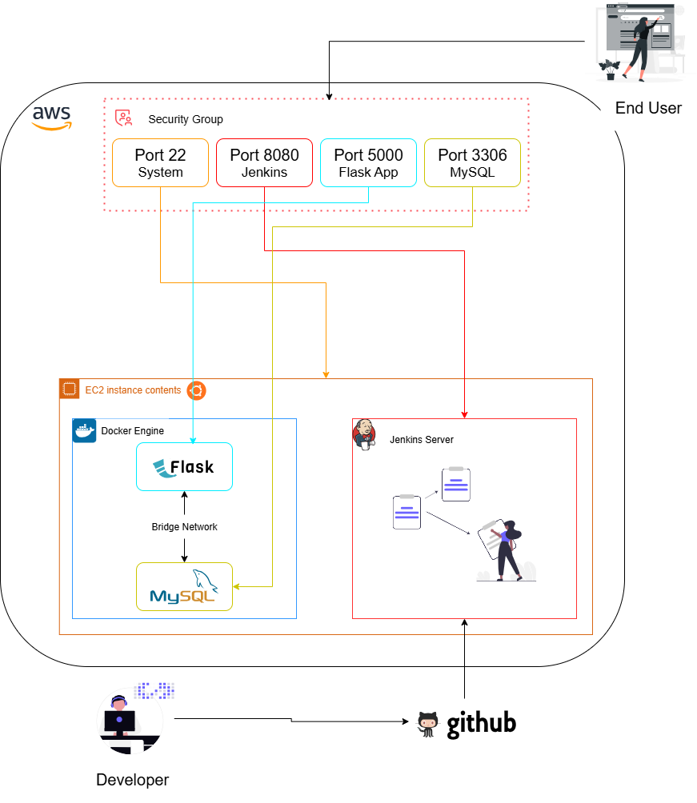
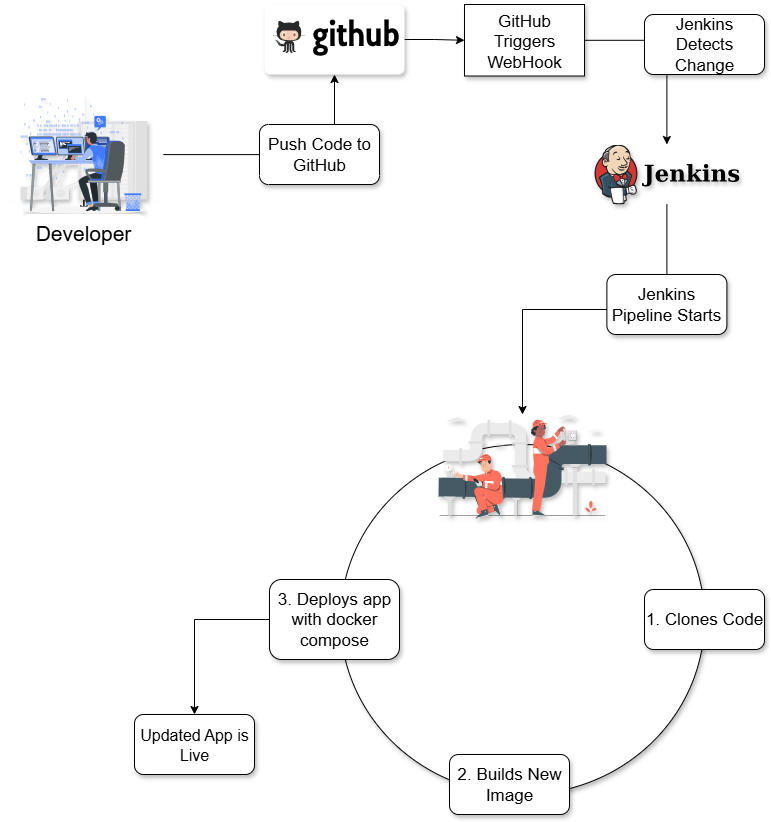

# DeployHub - Continuous Delivery for Cloud Applications 🚀

[](https://github.com/dhruuv-patil/DeployHub/actions)


**DeployHub** is a production-grade, two-tier web application built using **Flask** and **MySQL**, fully containerized with **Docker**, orchestrated using **Docker Compose**, and deployed onto an **AWS EC2** instance via automated **Jenkins CI/CD** pipelines and **GitHub Actions**.

---

## 📑 Table of Contents

1. [Overview](#-overview)
2. [System Architecture](#-system-architecture)
3. [Technology Stack](#-technology-stack)
4. [Key Features](#-key-features)
5. [Repository & Project Structure](#-repository--project-structure)
6. [Quick Start (Local Development)](#-quick-start-local-development)
   - [Option A: Run with Docker Compose](#option-a-run-with-docker-compose-recommended)
   - [Option B: Run Natively with Python](#option-b-run-natively-with-python)
7. [Automated Testing Suite](#-automated-testing-suite)
8. [REST API Endpoints](#-rest-api-endpoints)
9. [AWS EC2 & Jenkins Deployment Guide](#-aws-ec2--jenkins-deployment-guide)
   - [Step 1: EC2 Instance Provisioning](#step-1-ec2-instance-provisioning)
   - [Step 2: Security Group Configuration](#step-2-security-group-configuration)
   - [Step 3: Jenkins Installation & Setup](#step-3-jenkins-installation--setup)
   - [Step 4: Jenkins Pipeline Configuration](#step-4-jenkins-pipeline-configuration)
   - [Step 5: Automated Build & Deployment Execution](#step-5-automated-build--deployment-execution)
10. [Continuous Delivery Workflows](#-continuous-delivery-workflows)
11. [Author & License](#-author--license)

---

## 🌟 Overview

Modern software engineering relies on reliable, repeatable, and automated deployment practices. **DeployHub** implements continuous delivery patterns for cloud applications:

- **Two-Tier Architecture**: Clean separation of web presentation/API logic (Flask) and data persistence (MySQL 8.0).
- **Multi-Container Orchestration**: Docker Compose manages container life cycles, volume persistence, and isolated bridge networks.
- **Automated Health Monitoring**: Built-in `/health` endpoint with container-level and host-level validation to prevent downtime during updates.
- **Continuous Integration & Delivery**: Jenkins automatically pulls commits from GitHub, executes unit tests, builds fresh Docker images, and restarts services with zero manual overhead.

---

## 🏗️ System Architecture

### High-Level Architecture Flow

```text
  Developer Push
        │
        ▼
   GitHub Repo ─────────► GitHub Actions (Automated Tests & Docker Build)
        │
   Webhook Trigger
        │
        ▼
  Jenkins Server (AWS EC2)
        │
        ├── 1. Check out repository
        ├── 2. Execute pytest test suite
        ├── 3. Build Docker container image
        ├── 4. Orchestrate with Docker Compose
        └── 5. Validate health status (/health)
        │
        ▼
 ┌──────────────────────────────────────────────────┐
 │ AWS EC2 Instance (Security Group: 22, 80, 5000)  │
 │                                                  │
 │  Docker Engine (Bridge Network: two-tier-nt)     │
 │  ┌───────────────────────┐  ┌──────────────────┐ │
 │  │ Flask App (Port 5000) │◄─┤ MySQL (Port 3306)│ │
 │  └───────────────────────┘  └────────┬─────────┘ │
 │                                      │           │
 │                              Named Volume        │
 │                             (mysql_data)         │
 └──────────────────────────────────────────────────┘
```

### Detailed Infrastructure Diagram


### Continuous Delivery Workflow Diagram


---

## 🛠️ Technology Stack

| Domain | Technologies |
|---|---|
| **Backend** | Python 3.9+, Flask 2.2, Werkzeug, Gunicorn |
| **Database** | MySQL 8.0 (with Docker Named Volume persistence) |
| **Testing** | Pytest, Flask Test Client |
| **Containerization** | Docker, Dockerfile, Docker Compose v2 |
| **Continuous Integration** | Jenkins Pipeline-as-Code (`Jenkinsfile`), GitHub Actions |
| **Cloud Infrastructure** | AWS EC2 (Ubuntu 22.04 LTS), Security Groups, VPC |
| **Networking** | Docker Bridge Network (`two-tier-nt`), Port Forwarding |
| **Frontend** | Responsive Dark Theme UI, HTML5, CSS3, Vanilla JavaScript, AJAX |

---

## ✨ Key Features

- **Production Healthcheck**: `/health` endpoint tests both service liveness and database ping connectivity, adhering to Docker and AWS ALB standards.
- **Fault-Tolerant Initialization**: `init_db()` implements exponential retry logic to handle database initialization delays gracefully.
- **Environment Flexibility**: Fully configurable via `.env` variables with automatic fallback adapter for local testing environments without MySQL C-libraries.
- **RESTful API**: Supports `/submit`, `/api/messages`, `/api/info`, and `/health` for programmatic interaction.
- **Zero-Downtime Pipeline**: Jenkins automated pipeline verifies health post-deployment before completing the stage.
- **Data Persistence**: Uses named Docker volume `mysql_data` ensuring no data loss across container teardowns and updates.

---

## 📂 Repository & Project Structure

```text
DeployHub/
├── .github/
│   └── workflows/
│       └── ci.yml               # GitHub Actions CI workflow (tests + docker build)
├── diagrams/                    # Architectural diagrams and AWS setup screenshots
│   ├── Infrastructure.png       # EC2 + Docker bridge architecture diagram
│   ├── project_workflow.png     # CI/CD pipeline workflow diagram
│   ├── 01.png                   # AWS EC2 Instance console
│   ├── 02.png                   # Security Group inbound configuration
│   ├── 03.png                   # Jenkins Admin setup wizard
│   ├── 04.png                   # Jenkins Pipeline SCM configuration
│   ├── 05.png                   # Jenkins Build #1 execution log
│   └── 06.png                   # Jenkins Build #2 successful continuous delivery
├── static/
│   ├── css/
│   │   └── style.css            # Modern glassmorphism UI styles
│   ├── js/
│   │   └── app.js               # Dynamic AJAX message feed & tab controller
│   └── images/                  # System icons, author badge & diagrams
├── templates/
│   └── index.html               # DeployHub dashboard Jinja2 template
├── tests/
│   ├── __init__.py
│   └── test_app.py              # Automated pytest suite (9 tests)
├── .dockerignore                # Excludes non-essential files from Docker context
├── .env.example                 # Example environment variables template
├── .gitignore                   # Git exclusion rules
├── Dockerfile                   # Multi-stage optimized Docker build definition
├── Jenkinsfile                  # Jenkins Declarative Pipeline-as-Code
├── README.md                    # Comprehensive project documentation
├── app.py                       # Core Flask application, API routes & DB handler
├── docker-compose.yml           # Multi-container orchestration definition
├── message.sql                  # Database table schema and seed data
├── pytest.ini                   # Pytest test suite configuration
└── requirements.txt             # Pinned Python package dependencies
```

---

## 🚀 Quick Start (Local Development)

### Clone the Repository

```bash
git clone https://github.com/dhruuv-patil/DeployHub.git
cd DeployHub
```

### Option A: Run with Docker Compose (Recommended)

Start the entire multi-container stack with a single command:

```bash
docker compose up -d --build
```

Verify running containers:

```bash
docker compose ps
```

Expected output:
```text
NAME            IMAGE               COMMAND                  SERVICE      STATUS
mysql           mysql:8.0           "docker-entrypoint.s…"   mysql        Up (healthy)
two-tier-app    deployhub-flask-app "python app.py"          flask-app    Up (healthy)
```

Access the application:
- **Web UI**: [http://localhost:5000](http://localhost:5000)
- **Health Check**: [http://localhost:5000/health](http://localhost:5000/health)
- **API Messages**: [http://localhost:5000/api/messages](http://localhost:5000/api/messages)

To stop services:
```bash
docker compose down
```

---

### Option B: Run Natively with Python

1. **Create and activate a virtual environment**:
   ```bash
   python3 -m venv venv
   source venv/bin/activate    # On Windows: venv\Scripts\activate
   ```

2. **Install dependencies**:
   ```bash
   pip install -r requirements.txt
   ```

3. **Run the application**:
   ```bash
   python3 app.py
   ```

The app will initialize and start serving at `http://localhost:5000`.

---

## 🧪 Automated Testing Suite

DeployHub includes a complete automated test suite using `pytest`. The tests validate:
- System `/health` endpoint response and JSON schema.
- `/api/info` project metadata and repository details.
- Homepage `/` Jinja2 rendering.
- Message submission via form-data and JSON payloads.
- Input validation (rejection of empty messages and payloads exceeding 500 characters).
- Message retrieval and message clearing API endpoints.

To run the test suite:

```bash
pytest -v
```

Output:
```text
tests/test_app.py::test_health_check PASSED                              [ 11%]
tests/test_app.py::test_info_endpoint PASSED                             [ 22%]
tests/test_app.py::test_index_page PASSED                                [ 33%]
tests/test_app.py::test_submit_message_form PASSED                       [ 44%]
tests/test_app.py::test_submit_message_json PASSED                       [ 55%]
tests/test_app.py::test_submit_empty_message PASSED                      [ 66%]
tests/test_app.py::test_submit_message_exceeding_length PASSED           [ 77%]
tests/test_app.py::test_get_messages_api PASSED                          [ 88%]
tests/test_app.py::test_clear_messages_api PASSED                        [100%]

============================== 9 passed in 0.19s ===============================
```

---

## 📡 REST API Endpoints

| Method | Endpoint | Description | Sample Response |
|---|---|---|---|
| `GET` | `/` | Web dashboard & live message board | HTML Document |
| `GET` | `/health` | Application & database health validation | `{"status":"healthy","database":"connected"}` |
| `POST` | `/submit` | Submit a new deployment log / message | `{"status":"success","message":"...","created_at":"..."}` |
| `GET` | `/api/messages` | Retrieve all stored messages as JSON | `{"count":3,"messages":[...]}` |
| `POST` | `/api/clear` | Clear all stored messages | `{"status":"success","message":"All messages cleared"}` |
| `GET` | `/api/info` | Application metadata and repo links | `{"app_name":"DeployHub","author":"Dhruv Patil",...}` |

---

## ☁️ AWS EC2 & Jenkins Deployment Guide

### Step 1: EC2 Instance Provisioning

1. Navigate to the **AWS Management Console** and select **EC2**.
2. Launch a new instance with the following specifications:
   - **AMI**: Ubuntu 22.04 LTS (HVM)
   - **Instance Type**: `t2.micro` (AWS Free Tier eligible)
   - **Key Pair**: Select or create an SSH `.pem` key pair
   - **Storage**: Default 8 GB gp3 SSD
3. Allocate an Elastic IP or note the Public IPv4 address assigned to your instance.

---

### Step 2: Security Group Configuration

Configure inbound firewall rules in your AWS EC2 Security Group:

| Port | Protocol | Source | Purpose |
|---|---|---|---|
| `22` | TCP | Admin IP / `0.0.0.0/0` | SSH Administrative Shell Access |
| `80` | TCP | `0.0.0.0/0` | HTTP Web Traffic |
| `5000` | TCP | `0.0.0.0/0` | DeployHub Web Application |
| `8080` | TCP | `0.0.0.0/0` | Jenkins CI/CD Automation Dashboard |

---

### Step 3: Jenkins Installation & Setup

1. **Connect to the EC2 instance via SSH**:
   ```bash
   ssh -i your-key.pem ubuntu@<ec2-public-ip>
   ```

2. **Install Docker and Docker Compose**:
   ```bash
   sudo apt update && sudo apt install -y git docker.io docker-compose-v2
   sudo systemctl enable --now docker
   sudo usermod -aG docker ubuntu
   ```

3. **Install OpenJDK and Jenkins**:
   ```bash
   sudo apt install -y openjdk-17-jdk
   curl -fsSL https://pkg.jenkins.io/debian-stable/jenkins.io-2023.key | sudo tee /usr/share/keyrings/jenkins-keyring.asc > /dev/null
   echo deb [signed-by=/usr/share/keyrings/jenkins-keyring.asc] https://pkg.jenkins.io/debian-stable binary/ | sudo tee /etc/apt/sources.list.d/jenkins.list > /dev/null
   sudo apt update && sudo apt install -y jenkins
   sudo usermod -aG docker jenkins
   sudo systemctl restart jenkins
   ```

4. **Access Jenkins Web UI**:
   Navigate to `http://<ec2-public-ip>:8080`, retrieve the initial admin password via:
   ```bash
   sudo cat /var/lib/jenkins/secrets/initialAdminPassword
   ```
   Follow the wizard to install suggested plugins and create your admin account.

---

### Step 4: Jenkins Pipeline Configuration

1. In the Jenkins dashboard, select **New Item** ➔ Name: `DeployHub` ➔ Select **Pipeline** ➔ Click **OK**.
2. Under the **Pipeline** configuration tab:
   - **Definition**: *Pipeline script from SCM*
   - **SCM**: *Git*
   - **Repository URL**: `https://github.com/dhruuv-patil/DeployHub.git`
   - **Branch Specifier**: `*/main`
   - **Script Path**: `Jenkinsfile`
3. Click **Save**.

---

### Step 5: Automated Build & Deployment Execution

1. Click **Build Now** to trigger the continuous delivery pipeline.
2. The pipeline checks out the repository, executes automated pytest unit tests, builds the fresh Docker image, deploys via Docker Compose, and validates the `/health` endpoint.
3. Once completed, DeployHub is live and serving traffic at `http://<ec2-public-ip>:5000`!

---

## 🔄 Continuous Delivery Workflows

### Jenkins Declarative Pipeline (`Jenkinsfile`)
```groovy
pipeline {
    agent any

    environment {
        REPO_URL = 'https://github.com/dhruuv-patil/DeployHub.git'
        APP_IMAGE = 'deployhub-app:latest'
        APP_HEALTH_URL = 'http://localhost:5000/health'
    }

    stages {
        stage('Clone / Checkout Repository') {
            steps {
                checkout scm
            }
        }

        stage('Automated Tests') {
            steps {
                sh 'python3 -m pytest -v tests/'
            }
        }

        stage('Build Docker Image') {
            steps {
                sh "docker build -t ${APP_IMAGE} ."
            }
        }

        stage('Deploy with Docker Compose') {
            steps {
                sh 'docker compose down || true'
                sh 'docker compose up -d --build'
            }
        }

        stage('Validate Deployment') {
            steps {
                sh '''
                    for i in 1 2 3 4 5; do
                        if curl -sf "${APP_HEALTH_URL}"; then
                            echo "DeployHub is healthy and operational!"
                            exit 0
                        fi
                        sleep 5
                    done
                    exit 1
                '''
            }
        }
    }
}
```

---

## 👨‍💻 Author & License

**Developed by:** [Dhruv Patil](https://github.com/dhruuv-patil)  
**GitHub Repository:** [https://github.com/dhruuv-patil/DeployHub](https://github.com/dhruuv-patil/DeployHub)

*This project is distributed under the MIT License for educational and portfolio demonstration of modern DevOps, Cloud Deployment, and Continuous Delivery practices.*
